# Gram Altın ile BES Kararı: Bulgular

Bu dosya projenin raporudur. Her adımda elde edilen tablolar, grafikler ve yorumlar buraya işlenir. Plan ve karar kaydı için: [PLAN.md](PLAN.md).

> **Sürüm: 22 Kasım 2026 güncellemesi.** Veri 20 Kasım 2026 kapanışına kadar, karar günü 22 Aralık 2026, ufuk h = 22 iş günü. Önceki sürüm (veri 22 Ekim'e kadar, h = 43) `zaman_serisi_R_proje_22Ekim.zip` içinde saklı.

| Adım | Konu | Ders | Durum | Kod |
|---|---|---|---|---|
| 1 | Problem tanımı | Bölüm 1 | ✅ | `01_veri.R` |
| 2 | Veri hazırlığı | Bölüm 2.1, 3.2 | ✅ | `01_veri.R`, `01b_pazar_tatil_karsilastirma.R` |
| 3 | Keşifsel analiz | Bölüm 2 | ✅ | `02_kesif.R` |
| 4 | Dönüşüm ve günlük değişimler | Bölüm 2.9, 3.2, 3.3 | ✅ | `03_donusum.R` |
| 5 | Kıyaslama yöntemleriyle tahmin | Bölüm 3.1 | ✅ | `04_tahmin.R` |
| 6 | Doğruluk değerlendirmesi | Bölüm 3.3, 3.4 | ✅ | `04_tahmin.R` |
| 7 | Tahmin aralıkları ve karar olasılığı | Bölüm 3.5 | ✅ | `04_tahmin.R` |
| 8 | Sonuç ve karar | Bölüm 1.2, 1.4, 3.4 | ✅ | `04_tahmin.R` |
| 9 | Gerçek değerlendirme | Bölüm 1.6 | ⏳ | |

### Kısa özet

- **Soru:** BES'teki 33.443 TL'nin %30'unun %15'i, yani **1.504,94 TL** 22 Aralık'ta kazanılıyor. 5 gram altının 22 Aralık'a kadar değer artışı bu kazancı geçer mi? Geçmesi için gram fiyatının eşiği (6.048,71 TL = 20 Kasım kapanışı 5.747,72 + 1.504,94 / 5) aşması gerekiyor. Altında kalırsa B (BES), üstüne çıkarsa A (altın). Ufuk 22 iş günü.
- **Veri:** Investing.com GAU/TRY günlük kapanışları, 1 Ocak 2021 – 20 Kasım 2026. Pazarlar çıkarıldı, 2 tatil günü önceki kapanışla dolduruldu; 1.536 gözlem, `frequency = 5`.
- **Keşif:** 2021–2025 güçlü yükseliş trendi; 2026'da yatay seyir ve Kasım'da sert düşüş. Mevsimsellik yok. Log dönüşümü (λ = 0) kullanıldı.
- **Yöntemler:** Ortalama, naive, mevsimsel naive, drift. Eğitim/test ve tsCV ile kıyaslandı. Tüm dönemde en küçük hata drift'te (RMSE 294,7; fark çok küçük), 2026'da naive'de (448,8).
- **Seçilen yöntem:** Drift (tüm geçmiş). tsCV'de en küçük RMSE'yi verdiği için (kitabın kuralı, Bölüm 3.4). Yeni veri ve h = 22 ile sınama tekrarlandı; sıralama değişmedi.
- **Sonuç:** Nokta tahmini 5.960,67 TL (eşiğin 88 TL altı). P(B) = **%58**, P(A) = %42; beklenen fark 5 gram için −368 TL, B lehine. **B'ye hafif eğilim, karar belirsiz:** 22 günlük tipik hata (295–556 TL) aradaki farkın 3–6 katı. Bütün senaryolar B'yi gösteriyor (P(B) %58 – %77).

---

## 1. Problem tanımı

**Senaryo (proje sahibi, 23 Kasım):** BES'te 33.443 TL var. Bu paranın %30'unun %15'i 22 Aralık'ta kazanılıyor. Bu kazanç, 5 gram altının aynı tarihe kadar ne kadar değer kazanacağıyla karşılaştırılıyor.

| Büyüklük | Hesap | Değer |
|---|---|---|
| BES kazancı | 33.443 × 0,30 × 0,15 | **1.504,94 TL** |
| P₀ | Son tamamlanmış kapanış (20 Kasım 2026, Cuma; 22 Kasım Pazar) | 5.747,723 TL |
| 5 gram altının değer artışı | 5 × (P₂₂ Aralık − P₀) | tahmin edilecek |
| Eşik (başa baş fiyat) | 5 × (P − P₀) = 1.504,94 → P = P₀ + 1.504,94 / 5 = P₀ + 300,99 | **6.048,710 TL** (P₀'ın %5,24 üstü) |
| h | 23 Kasım – 22 Aralık arası hafta içi gün sayısı | **22** |

**Karar kuralı:** 22 Aralık kapanışı eşiğin üstündeyse 5 gram altının değer artışı BES kazancından büyük (**A: altın**); altındaysa BES kazancı büyük (**B: BES**). Gram fiyatının 22 iş gününde en az 300,99 TL (%5,24) artması gerekiyor.

Örnek: 22 Aralık fiyatı 6.200 TL olursa altın 5 × 452,28 = 2.261 TL kazandırır (> 1.504,94 → A); 5.900 TL olursa 761 TL kazandırır (< 1.504,94 → B).

Bölüm 1.7'ye göre karar günündeki fiyat bugünden bilinmeyen rastgele bir değişkendir. Projenin asıl çıktısı tek bir nokta tahmini değil, **tahmin dağılımı** ve bu dağılıma göre P(fiyat < eşik) olasılığıdır.

---

## 2. Veri ve hazırlık

**Kaynak:** Investing.com, GAU/TRY günlük verisi. Kullanılan sütun "Şimdi" (gün sonu kapanışı). Ham dosya `data/GAU_TRY Geçmiş Verileri 20Kasim.csv` hiç değiştirilmedi. Önceki ham dosya (22 Ekim) da `data/` içinde duruyor; 22 Ekim'e kadarki 1.714 günün hepsinde iki dosyanın kapanışları birebir aynı.

**Ham veri kontrolleri:** 1.739 satır, 1 Ocak 2021 – 20 Kasım 2026. Boş kapanış ve tekrarlı tarih yok.

| Gün | Pzt | Sal | Çar | Per | Cum | Cmt | Paz |
|---|---|---|---|---|---|---|---|
| Satır sayısı | 307 | 307 | 307 | 307 | 306 | 0 | 205 |

### 2.1 Takvim düzenlemesi (Bölüm 3.2)

| Düzenleme | Satır | Gerekçe |
|---|---|---|
| Pazar satırları çıkarıldı | 205 | Aşağıda 2.2 |
| İndirme günü (yarım gün) satırı | 0 | Bu dosyada son satır 20 Kasım, kapanmış bir gün (22 Ekim sürümünde 23 Ekim'in yarım satırı çıkarılmıştı) |
| Tatil günleri önceki kapanışla dolduruldu | 2 | Aşağıda 2.3 |

**Sonuç:** 1.536 gözlem, 1 Ocak 2021 – 20 Kasım 2026, her hafta Pazartesi'den Cuma'ya.

### 2.2 Pazar satırları

**Karar:** Pazarlar çıkarıldı. Cuma'dan sonra Pazartesi gelir; aradaki günler piyasanın kapalı olduğu, fiyatın değişmediği günler sayılır.

**Gerekçe (Bölüm 2.1 ve 3.2):**
- **Takvim düzenlemesi (3.2):** Takvimden gelen bilinen varyasyon modellemeden önce kaldırılır; kitap satış verisi için "işlem günü başına modelle" diyor. Altın piyasası hafta içi işlem görüyor, bu yüzden seri işlem günleriyle kuruldu.
- **Frekans (2.1):** Kitap, günlük veride hangi mevsimselliğin önemli olduğuna karar verilmesini istiyor. Pazarlar ham veride düzensiz (bazı yıllarda var, 2024'te hiç yok). Pazarları tutmak her haftanın gözlem sayısını değiştirir ve sabit bir frekans tanımlanamaz. Pazarsız seride her hafta 5 iş günü, frekans 5.

*(Pazarlı ve Pazarsız serinin ayrıntılı betimsel karşılaştırması ders dışı olduğu için rapordan çıkarıldı; `01b_pazar_tatil_karsilastirma.R` içinde arşiv olarak duruyor.)*

### 2.3 Eksik hafta içi günler (tatiller)

| Eksik gün | Önceki kapanış (Per) | Sonraki kapanış (Pzt) | Aradaki log değişim |
|---|---|---|---|
| 18 Nisan 2025, Cuma (Paskalya) | 4.064,165 | 4.224,525 | +0,03870 |
| 3 Nisan 2026, Cuma (Paskalya) | 6.683,808 | 6.681,974 | −0,00027 |

23 Ekim – 20 Kasım arasına eklenen 20 iş gününde eksik gün yok (29 Ekim dahil işlem görmüş).

| Seçenek | Sonuç | Sorunu |
|---|---|---|
| **(a) Önceki kapanışla doldurmak** ✅ | Cuma değişimi 0, hareketin tamamı Pazartesi'ye yazılır | 2 gün sıfır değişim ekler (1.536 gözlemde ihmal edilebilir) |
| (b) Ara değer | 2025 için Cuma = 4.143,569; değişim 0,01935 + 0,01935 olarak ikiye bölünür | Kapalı piyasaya yaşanmamış bir hareket yazar |
| (c) Boş bırakmak | O haftalar 4 gözlem olur | 18 Nisan 2025 sonrasındaki 415 gözlemin haftanın günü konumu kayar |

Toplam değişim üç seçenekte de aynı. **Karar:** (a). Hafta sonu kararıyla aynı mantık: piyasa kapalıyken fiyat değişmez.

### 2.4 ts nesnesi ve frekans (Bölüm 2.1)

`ts(kapanis, start = c(1, 5), frequency = 5)`: bir "mevsim" bir haftadır (1 = Pzt … 5 = Cum). İlk gözlem 1 Ocak 2021 Cuma olduğu için `start = c(1, 5)`. Kontrol: her gözlemin `cycle()` değeri gerçek gün adıyla birebir tutuyor.

Gerekçe:
- Tatiller doldurulduğu için her hafta tam 5 gözlem var.
- Ortalama, naive ve drift yöntemleri frekanstan etkilenmez.
- Ljung-Box'ta önerilen gecikme sayısı değişmez (aşağıda 4. bölümdeki yöntem notu).
- Mevsimsel naive yöntemi ve haftanın günlerine göre grafikler kullanılabilir.

---

## 3. Keşifsel analiz (Bölüm 2)

### 3.1 Zaman grafiği

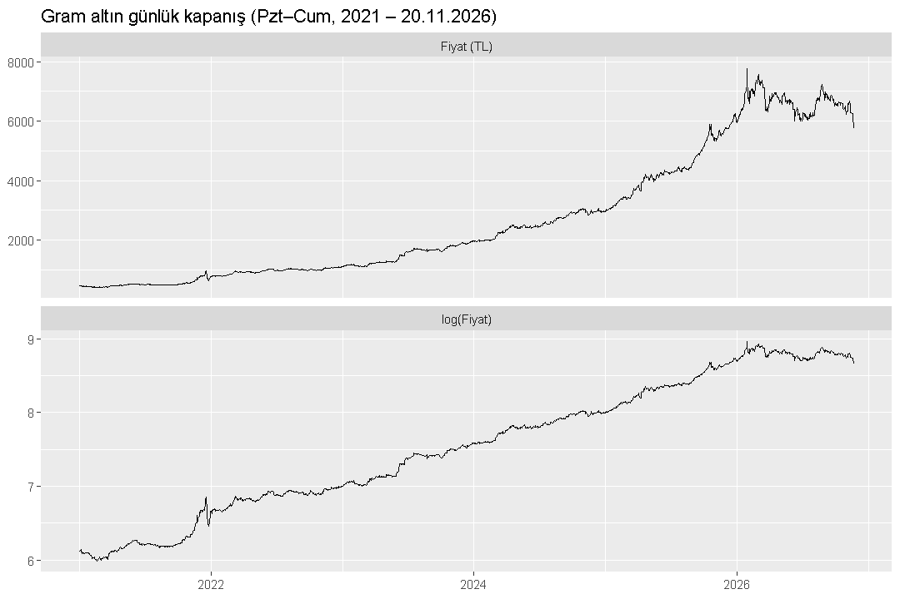

| Yıl | İlk kapanış | Son kapanış | En düşük | En yüksek | Yıl içi değişim |
|---|---|---|---|---|---|
| 2021 | 454,1 | 779,7 | 397,2 | 950,1 | +%71,7 |
| 2022 | 759,6 | 1.096,9 | 759,6 | 1.096,9 | +%44,4 |
| 2023 | 1.102,3 | 1.940,3 | 1.096,1 | 1.964,9 | +%76,0 |
| 2024 | 1.961,2 | 2.983,7 | 1.945,7 | 3.070,6 | +%52,1 |
| 2025 | 2.984,4 | 5.951,5 | 2.984,4 | 6.245,7 | +%99,4 |
| 2026 (20 Kasım'a kadar) | 6.010,5 | 5.747,7 | **5.747,7** | 7.778,6 | **−%4,4** |

Tüm dönemin zirvesi: 28 Ocak 2026, 7.778,57 TL.

- **Güçlü bir artış trendi var.** TL ölçeğinde eğri giderek dikleşiyor, log ölçekte neredeyse doğrusal. Altın sabit bir TL miktarı kadar değil, yaklaşık sabit bir yüzde kadar artmış.
- **Dalgalanma seviyeyle birlikte büyüyor.** 2021'de birkaç on TL, 2026'da bine yakın. Log/Box-Cox dönüşümü için gerekçe bu (Bölüm 3.2).
- **Trend 2026'da yön değiştiriyor.** Ocak zirvesinden sonra seri 6.000–7.500 TL bandında yatay; Kasım'da sert düşüşle 20 Kasım kapanışı (5.747,7) yılın en düşüğü oldu. 2026, verideki ilk düşüş yılı.
- **Olağandışı gözlemler** iki dönemde kümeleniyor: Kasım–Aralık 2021 ve Ocak 2026.

| Tarih | Günlük log değişim |
|---|---|
| 20 Ara 2021 | −0,1932 |
| 23 Kas 2021 | +0,1066 |
| 30 Oca 2026 | −0,0970 |
| 21 Ara 2021 | −0,0928 |
| 22 Mar 2021 | +0,0784 |
| 28 Oca 2026 | +0,0755 |

Bu günler veride bırakıldı; olayların haberlerle açıklanması bu projenin kapsamı (sadece veri ve ders notları) dışında tutuldu.

### 3.2 Trend, mevsimsellik, döngüsellik (Bölüm 2.3)

| Bileşen | Bulgu |
|---|---|
| Trend | Var; 2026'da durdu, yıl sonuna doğru düşüşe döndü |
| Mevsimsellik | Görünmüyor (3.3–3.6) |
| Döngüsellik | 6 yıllık veriyle ayırt edilemiyor. Kitaptaki hazine bonosu örneğindeki gibi, kısa pencerede trend görünen şey uzun bir döngünün parçası olabilir |

### 3.3 Mevsimsel grafik (Bölüm 2.4)

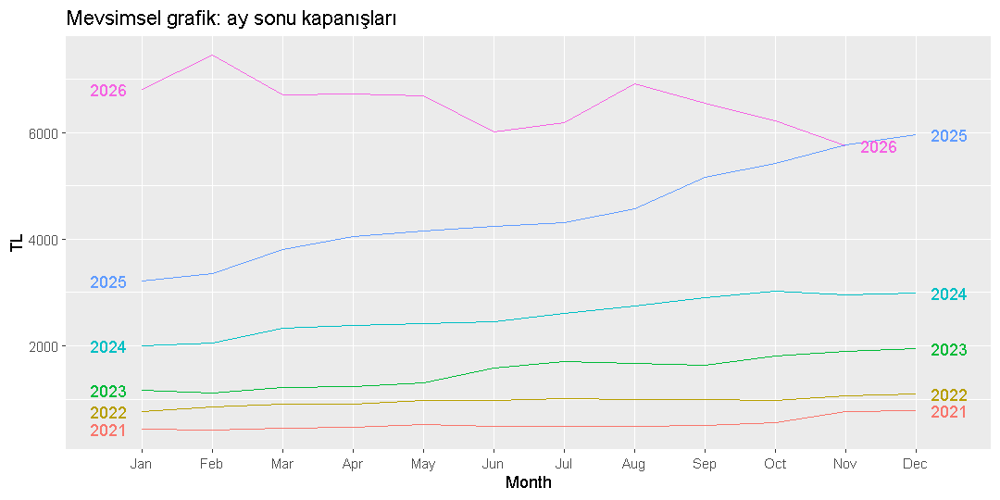

Yıl çizgilerinin ortak bir şekli yok: 2021–2025 yıl boyunca yükseliyor, 2026 iniş-çıkışlı ve sonbaharda düşüyor. Belirli aylarda tekrar eden bir hareket görünmüyor. Kutupsal versiyon: `ciktilar/3_3_mevsimsel_polar.png` (yeni bilgi vermiyor).

### 3.4 Mevsimsel alt seri grafiği (Bölüm 2.5)

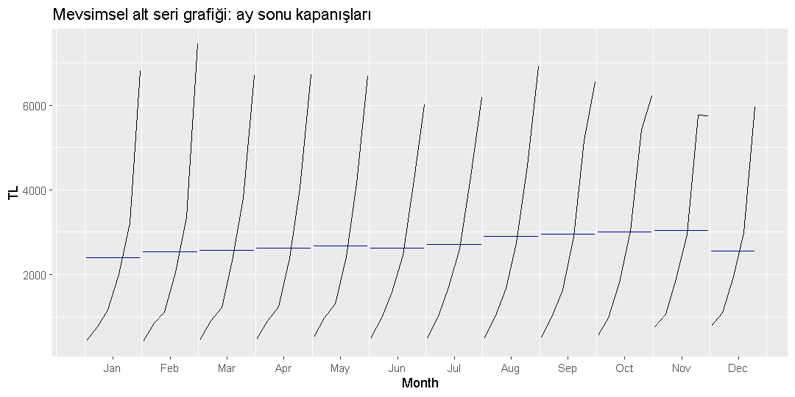

Her ayın mini serisi aynı yükselen eğri. Ay ortalamaları (yatay çizgiler) arasındaki farkları trend belirliyor, mevsimsellik değil: yüksek 2026 değerleri hangi aylara düşüyorsa o ayların ortalaması yüksek görünüyor.

Seviyelerde trend her şeyi bastırdığı için ayrıca her ayın kendi içindeki yüzde değişimine bakıldı (ay sonu / önceki ay sonu):

| Ay | n | Ortalama | En az | En çok |
|---|---|---|---|---|
| Oca | 5 | %6,0 | −1,4 | 14,3 |
| Şub | 6 | %3,0 | −4,9 | 10,3 |
| Mar | 6 | %7,2 | −9,9 | 13,5 |
| Nis | 6 | %2,4 | −0,9 | 6,4 |
| May | 6 | %4,3 | −0,4 | 10,5 |
| Haz | 6 | %1,5 | −10,2 | 20,0 |
| Tem | 6 | %3,9 | −0,4 | 8,0 |
| Ağu | 6 | %2,9 | −2,1 | 11,8 |
| Eyl | 6 | %2,3 | −5,2 | 13,3 |
| Eki | 6 | %4,0 | −5,1 | 10,8 |
| Kas | 6 | %8,4 | −7,6 | 39,8 |
| Ara | 5 | %2,2 | 0,8 | 3,2 |

Kasım 2026 değeri 20 Kasım'a kadardır (−%7,6). Tahmin ufkumuz Kasım sonu–Aralık'ı kapsıyor:
- Kasım'ın yüksek ortalamasını tek bir gözlem taşıyor (2021'de +%39,8); 2026'da ise en düşük değer.
- Aralık'ın 5 değerinin hepsi pozitif ama küçük.
- 5–6 gözlemle bunlar kanıt değil, yalnızca görsel izlenim.

### 3.5 Gecikme grafikleri (Bölüm 2.7)

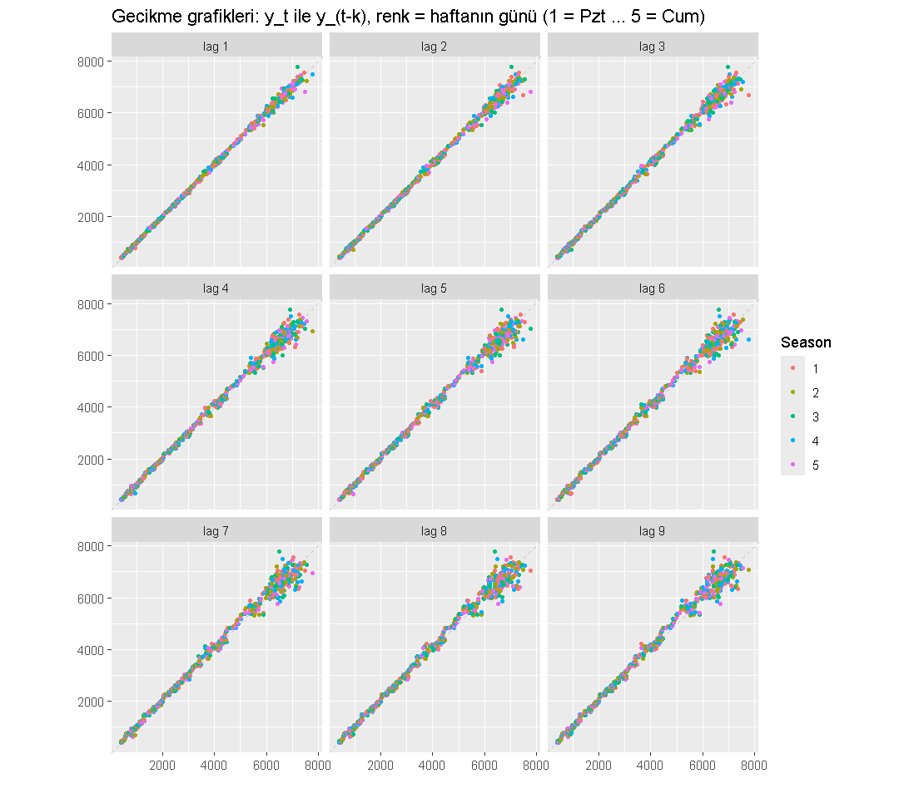

1'den 9'a kadar tüm gecikmelerde noktalar köşegen üzerinde: trendli seride beklenen çok güçlü pozitif ilişki. 6.000 TL üstünde (2026) ve gecikme büyüdükçe dağılma artıyor. Renkler (haftanın günleri) karışık; fiyat seviyesinde haftalık bir desen yok.

### 3.6 ACF (Bölüm 2.8)

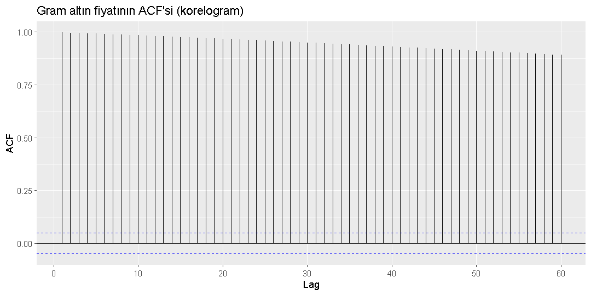

| r1 | r2 | r5 | r10 | r20 | r40 | r60 |
|---|---|---|---|---|---|---|
| 0,999 | 0,997 | 0,993 | 0,985 | 0,968 | 0,931 | 0,892 |

Beyaz gürültü sınırı ±2/√1536 = ±0,051; 60 çubuğun 60'ı sınırın dışında. Gecikme arttıkça yavaşça azalan pozitif ACF, kitapta trendli seriler için anlatılan görüntünün aynısı. 5, 10, 15. gecikmelerde "taraklı" bir yükselme yok, yani haftalık mevsimsellik izi yok.

### 3.7 Adım 3'ün sonraki adımlara etkisi

1. Log dönüşümü görsel olarak destekleniyor. Adım 4'te `BoxCox.lambda` ile sayısal olarak kontrol edildi.
2. Fiyat seviyesi beyaz gürültü değil (beklenen). Asıl soru günlük değişimlerin beyaz gürültü olup olmadığı; bu Adım 4'te sınandı.
3. Haftalık ve aylık mevsimsellik görünmüyor; mevsimsel naive'in naive'den iyi çıkması beklenmiyor (Adım 6'da sınandı).
4. Karar açısından asıl gerilim: 2021–2025 hızlı yükseliş, 2026 yatay ve düşüş. Tüm dönemle hesaplanan drift geçmişteki hızı geleceğe taşır, naive "fiyat aynı kalır" der. Hangisinin daha iyi tahmin ettiği Adım 6'da çapraz doğrulamayla sınandı.

---

## 4. Dönüşüm ve günlük değişimler

### 4.1 Box-Cox dönüşümü (Bölüm 3.2)

`BoxCox.lambda(y)` = **0,084**. R'ın otomatik seçimi neredeyse tam log (λ = 0). (22 Ekim sürümünde 0,291 çıkmıştı; Kasım verisiyle log'a yaklaştı. Otomatik λ seçimi verinin sonundaki birkaç haftaya bile duyarlı.)

Tam 0 çıkmamasının sebebi: λ = 0, dalgalanma fiyatla tam orantılı büyüyorsa doğru seçimdir. Bizde yüzde cinsinden oynaklık yıldan yıla değişiyor (4.2'deki yıllık std tablosu).

Notlardaki ilkeler:
- Basit bir λ seçin, açıklaması kolay olsun.
- Tahmin sonuçları λ'ya görece duyarsızdır.
- Dönüşümler nokta tahminlerinden çok tahmin aralıklarını etkiler.
- Log, yorumlanabilirdir ve tahminleri pozitif tutar.

**Karar: log (λ = 0).** Gerekçe:
- Log farkı yaklaşık yüzde değişim olarak okunur.
- Günlük değişimler toplanınca 22 günlük değişim çıkar.
- Eşik bir oran olarak yazılabilir: log(6.048,71 / 5.747,72) = 0,0510.

λ = 0,084 ile duyarlılık kontrolü Adım 7'de yapıldı.

### 4.2 Günlük değişimler: log fiyata naive yöntemin artıkları (Bölüm 3.3)

Kitaptaki Google örneğinin aynısı: log fiyata naive uygulanınca artıklar eₜ = log yₜ − log yₜ₋₁, yani günlük log değişim olur.

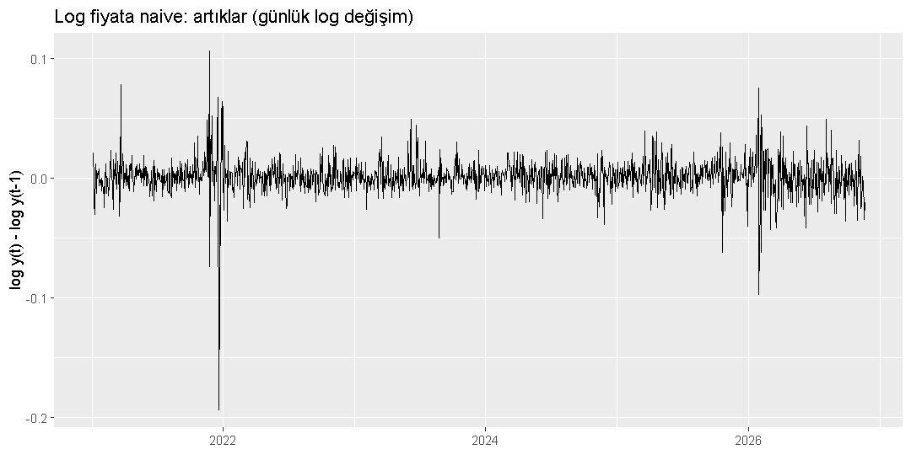

| n | Ortalama | Std | En küçük | En büyük |
|---|---|---|---|---|
| 1.535 | 0,00165 | 0,01470 | −0,1932 | +0,1066 |

**Artıkların ortalaması sıfır değil.** Kitaba göre ortalaması sıfırdan farklı olan artıklar, tahminlerin yanlı olduğunu gösterir. Naive "fiyat aynı kalır" diyor, ama gerçekte fiyat ortalama günde %0,17 artmış. Drift yöntemi tam olarak bu ortalamayı tahmine ekler. 22 iş gününe ölçeklenince 22 × 0,00165 = 0,0364 (yaklaşık **+%3,7**); bu, eşiğin (+%5,24, log 0,0510) **altında**.

**Varyans sabit değil.** Yıllara göre:

| Yıl | n | Ortalama | Std |
|---|---|---|---|
| 2021 | 260 | 0,00208 | **0,02170** |
| 2022 | 260 | 0,00131 | 0,01071 |
| 2023 | 260 | 0,00219 | 0,01067 |
| 2024 | 262 | 0,00164 | 0,00979 |
| 2025 | 261 | 0,00265 | 0,01236 |
| 2026 | 232 | **−0,00015** | **0,01913** |

- 2021 (Kasım–Aralık şoku) ve 2026, sakin yıllara göre yaklaşık iki kat oynak; zaman grafiğinde de oynak dönemler kümeleniyor.
- Kitaba göre sabit varyans gerekli değil ama tahmin aralıklarını kolaylaştıran bir özellik. Bu yüzden Adım 7'deki aralıkları etkiliyor.
- **Karar açısından:** 2026'nın ortalaması negatif (−0,00015); 22 güne ölçeklenince yaklaşık −%0,3. Tüm dönem ortalaması da (+%3,7) artık eşiğin altında. Yani hem uzun dönem hem 2026 ortalaması, 22 günde %5,24'lik artışın gerektirdiğinden az.

### 4.3 Beyaz gürültü mü? (Bölüm 2.9, 3.3)

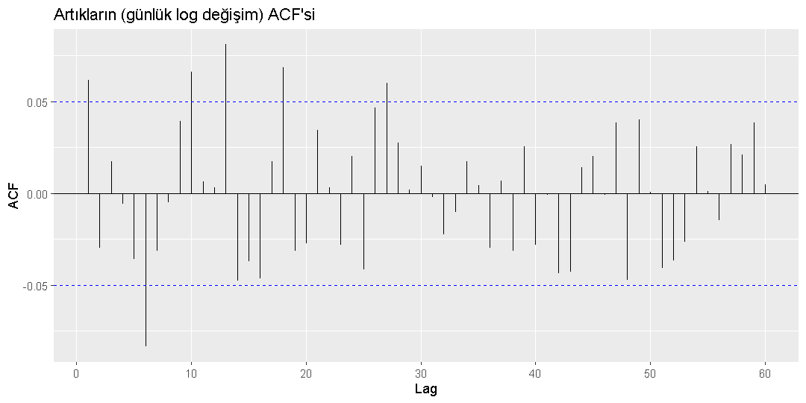

| r1 | r2 | r3 | r4 | r5 | r6 | r7 | r8 | r9 | r10 |
|---|---|---|---|---|---|---|---|---|---|
| 0,062 | −0,030 | 0,017 | −0,006 | −0,036 | **−0,084** | −0,031 | −0,005 | 0,039 | 0,066 |

Sınır ±0,051. 60 gecikmeden **6'sı** sınır dışında (gecikme 1, 6, 10, 13, 18, 27); şans eseri beklenen yaklaşık 3.

**Portmanteau testleri** (h = 10, K = 0; χ²(10) %5 kritik değeri 18,31):

| Test | İstatistik | sd | p |
|---|---|---|---|
| Box-Pierce | Q = 31,09 | 10 | 0,00057 |
| Ljung-Box | Q* = 31,25 | 10 | 0,00053 |

H₀ (beyaz gürültü) reddediliyor.

**Duyarlılık: sonuç 2021 şokuna mı bağlı?** Aynı Ljung-Box testi farklı başlangıç tarihleriyle:

| Başlangıç | T | Q* | p | En büyük \|r_k\| (k ≤ 10) | Sınır |
|---|---|---|---|---|---|
| 2021 | 1.535 | 31,25 | 0,0005 | 0,084 (k = 6) | ±0,051 |
| 2022 | 1.275 | 17,59 | **0,0623** | 0,081 (k = 6) | ±0,056 |
| 2023 | 1.015 | 13,50 | **0,1970** | 0,075 (k = 6) | ±0,063 |

**Yorum:**
- Günlük değişimlerde istatistiksel olarak anlamlı ama **çok küçük** otokorelasyonlar var. En büyüğü 0,08; korelasyonun karesiyle ölçülürse bir günün değişimi, geçmiş bir günün değişimiyle %1'den az ortak varyasyon paylaşıyor.
- Anlamlılık 2021'den geliyor. 2022 ve sonrasında %5 düzeyinde beyaz gürültü reddedilemiyor.
- Kitap, korelasyonlu artıkları düzeltmenin zor olduğunu söylüyor; ilk üç bölümün araçlarıyla bu yapı modellenemiyor. Sonuç olarak naive ve drift artıkları tam beyaz gürültü değil; bu, sınırlılıklara yazıldı.
- Kitabın notu: artık özelliklerini kontrol etmek önemli, ama yöntem seçmek için iyi bir yol değil. Yöntem seçimi Adım 6'da çapraz doğrulamayla yapıldı.
- Drift'in artıkları = bu artıklar − sabit ortalama. ACF aynıdır, dolayısıyla bu sonuç drift için de geçerli (orada K = 1, sd = 9).

### 4.4 Histogram ve normallik (Bölüm 3.3)

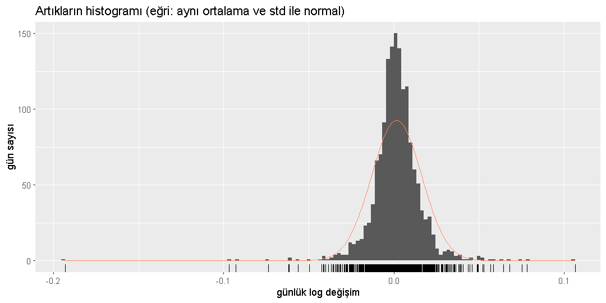

Histogramda çubuklar ortada normal eğrisinden daha yüksek, iki uçta da eğrinin dışına taşan günler var. Yani dağılım normalden hem daha sivri hem daha uzun kuyruklu. Kitaptaki Google örneğinin uyarısı burada da geçerli: nokta tahminleri iyi olsa bile **normal varsayımlı tahmin aralıkları yanlış olabilir**. Bu, Adım 7'de bootstrap aralıklarının gerekçesi.

### 4.5 Haftanın günlerine göre günlük değişim (Bölüm 2.5)

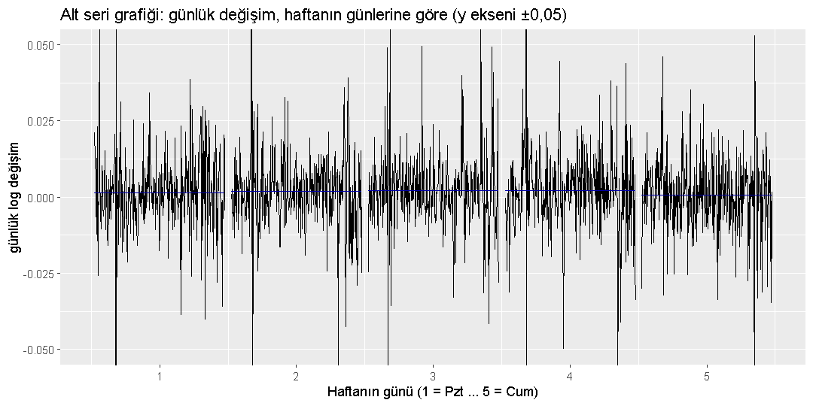

| Gün | n | Ortalama | Std |
|---|---|---|---|
| Pzt | 307 | 0,00151 | 0,01721 |
| Sal | 307 | 0,00183 | 0,01470 |
| Çar | 307 | 0,00217 | 0,01386 |
| Per | 307 | 0,00204 | 0,01401 |
| Cum | 307 | 0,00072 | 0,01349 |

- Ortalamalar arasındaki en büyük fark yaklaşık 0,0015. Her günün ortalamasının standart hatası yaklaşık 0,0147/√307 ≈ 0,0008; fark bunun iki katından az. Belirgin bir gün etkisi yok; alt seri grafiğindeki ortalama çizgileri de neredeyse aynı hizada.
- Pazartesi'nin std'si en yüksek. Beklenen bir durum: Pazartesi değişimi Cuma kapanışından itibaren 3 takvim gününü kapsıyor.
- Haftalık mevsimsellik yok; mevsimsel naive'in naive'den iyi çıkması beklenmiyor (Adım 6'da sınandı).

### 4.6 Adım 4'ün sonraki adımlara etkisi

1. **Naive yanlı, drift gerekçeli:** artık ortalaması 0,00165 > 0. Ama drift'in büyüklüğü döneme çok bağlı (2026'da −0,00015). Hangi yöntemin daha iyi tahmin ettiği Adım 6'nın ana sorusu.
2. **Yön tahmini zor:** otokorelasyonlar çok küçük ve 2022 sonrasında anlamlı değil. Notlardaki etkin piyasa uyarısıyla uyumlu.
3. **Normal aralıklar şüpheli:** kuyruklar uzun ve varyans zamanla değişiyor. Adım 7'de normal aralıkların yanında `bootstrap = TRUE` aralıkları da raporlandı.
4. **Dönüşüm:** Tüm yöntemler log ölçekte (λ = 0) uygulandı.

**Yöntem notu: Ljung-Box testi ve gecikme sayısı h (Bölüm 3.3).** ACF'de her gecikmeye ayrı ayrı bakmak, arka arkaya birçok hipotez testi yapmak demektir; bu testlerden biri şans eseri anlamlı çıkabilir (1. tip hata). Ljung-Box, ilk h otokorelasyonu tek testte toplar:

> Q* = T(T+2) · Σ_{k=1}^{h} r_k² / (T−k)
> H₀: seri beyaz gürültü. Q*, serbestlik derecesi (h − K) olan χ² dağılımıyla karşılaştırılır.

- h: kaç gecikmenin birlikte test edildiği. Kitap: mevsimsel olmayan veri için h = 10, mevsimsel veri için h = 2m. Bizde m = 5, yani 2m = 10. h, T/5'ten büyükse T/5 alınır; bizde T/5 = 307. (Buradaki h Ljung-Box'ın gecikme sayısıdır, tahmin ufku değil.)
- K: modeldeki parametre sayısı. Naive'de K = 0 (sd = 10), drift'te K = 1 (sd = 9).
- Sayısal örnek (T = 1.536, h = 10; varsayımsal değerler, gerçek sonuç yukarıda 4.3'te):
  - Tüm r_k = 0,02 ise Q* ≈ 6,2. Bu, χ²(10) için %5 kritik değeri olan 18,31'in altında; H₀ reddedilmez.
  - Tüm r_k = 0,06 ise Q* ≈ 55,4 > 18,31; H₀ reddedilir.

---

## 5. Kıyaslama yöntemleriyle tahmin (Bölüm 3.1)

Dört yöntem log ölçekte (λ = 0) uygulandı, h = 22. Geri dönüşüm basit yapıldı; bu yüzden nokta tahminleri tahmin dağılımının **medyanıdır** (Bölüm 3.2, yanlılık düzeltmesi Adım 7'de).

### 5.1 Karar günü (22. iş günü, 22 Aralık Salı) nokta tahminleri

| Yöntem | Neye dayanıyor | Tahmin (TL) | P₀'a göre | Eşiğe (6.048,71) göre |
|---|---|---|---|---|
| Ortalama | Tüm log fiyatların ortalaması (7,5408 → e^7,5408) | 1.883,28 | −%67,23 | altında (B) |
| Naive | Son kapanış | 5.747,72 | %0,00 | altında (B) |
| Mevsimsel naive | Geçen haftanın aynı günü (Salı, 17 Kasım) | 6.241,21 | +%8,59 | ÜSTÜNDE (A) |
| Drift | İlk ve son gözlemi birleştiren çizginin eğimi, 0,001654/gün | **5.960,67** | **+%3,70** | **altında (B)** |

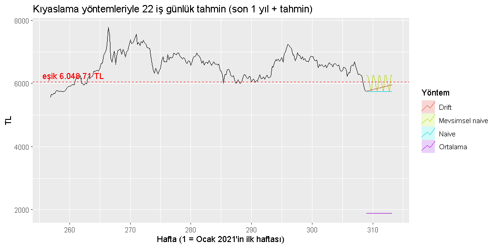

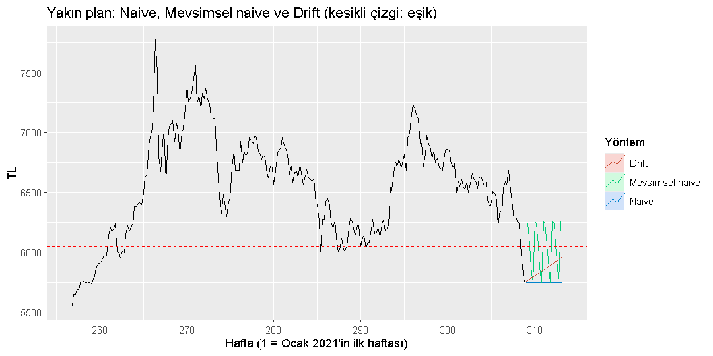

### 5.2 Yorum

- **Ortalama yöntemi bu seri için anlamsız.** 2021'den beri artan bir serinin ortalaması bugünkü fiyatın çok altında; kitaptaki Google örneğinde de aynı durum var. Sadece kıyaslama olarak tutuluyor.
- **Mevsimsel naive'in "A" demesinin anlamı yok.** Son haftanın 5 değerini (Pzt 6.261,58; Sal 6.241,21; Çar 6.068,11; Per 5.866,20; Cum 5.747,72) tekrar ediyor. Son hafta sert bir düşüş haftasıydı; 22. gün Salı'ya denk geldiği için haftanın başındaki yüksek değer (6.241,21) çıkıyor. Adım 3–4'te haftalık mevsimsellik görülmediği için bu bir tesadüf.
- **Drift'in eğimi, Adım 4'teki artık ortalamasının (0,00165) aynısı.** Log ölçekte 22 × 0,001654 = 0,0364 artış öngörüyor; eşik 0,0510. Drift bu hızla eşiğe ancak 31. iş gününde ulaşırdı, yani karar gününden sonra.
- **Naive ve drift bu kez aynı tarafta (B).** Önceki sürümde (h = 43) drift'in birikmiş artışı eşiği geçiyordu; ufuk 22 güne inince geçmiyor. 2026 verisiyle hesaplanan drift ise 22 günde yaklaşık −0,003 (düşüş) öngörürdü.
- **Bunlar sadece nokta tahminleri.** Eşiğin altında kalma olasılığı tahmin aralıklarından hesaplandı (Adım 7). Hangi yöntemin daha iyi tahmin ettiği Adım 6'da çapraz doğrulamayla sınandı.

## 6. Doğruluk değerlendirmesi

Kod: `04_tahmin.R` (Adım 6 bölümü). Bütün yöntemler log ölçekte (λ = 0). Hatalar TL cinsinden: eₜ = gerçek − tahmin.

### 6.1 Artık kontrolü (Bölüm 3.3)

| Yöntem | Artık ortalaması | sd | Ljung-Box Q* (lag 10) | p |
|---|---|---|---|---|
| Naive | +0,001654 | 0,01470 | 31,25 (K = 0) | 0,00053 |
| Mevsimsel naive | +0,008427 | 0,03393 | 1748,87 (K = 0) | ≈ 0 |
| Drift | 0,000000 | 0,01470 | 31,25 (K = 1) | 0,00027 |

- Drift'in artıkları naive artıklarından sabit eğimin (0,00165) çıkarılmış hâli. Bu yüzden ortalama tam sıfır, ACF'leri ve Q* değerleri aynı. Kitaptaki "ortalaması sıfır olmalı" koşulunu yalnızca drift sağlıyor.
- Mevsimsel naive'in artıkları 5 günlük toplam değişim. Bu artıklar birbiriyle örtüştüğü için çok güçlü otokorelasyon var (Q* = 1749), sd de naive'in 2,3 katı.
- Hiçbir yöntemin artıkları tam beyaz gürültü değil (Adım 4'teki küçük otokorelasyon).

### 6.2 Eğitim / test ayrımı (Bölüm 3.4)

Eğitim: 1 Ocak 2021 – 21 Ekim 2026 (1.514 gözlem). Test: son 22 iş günü (22 Ekim – 20 Kasım 2026).

| Yöntem | RMSE | MAE | MAPE (%) | MASE | 22. gün tahmini | Karar |
|---|---|---|---|---|---|---|
| Ortalama | 4.502,96 | 4.497,53 | 70,81 | 69,23 | 1.850,34 | B |
| **Naive** | **322,18** | **244,32** | **3,97** | **3,76** | 6.582,29 | B |
| Mevsimsel naive | 339,58 | 259,25 | 4,21 | 3,99 | 6.631,29 | B |
| Drift | 459,47 | 369,99 | 5,99 | 5,70 | 6.843,24 | B |

Bu ayrımda başlangıç fiyatı 6.582,29, o günkü eşik 6.926,98 (aynı +%5,24 oranı), gerçek 22. gün 5.747,72. **Gerçek sonuç B.** Bütün yöntemler doğru karar verdi.

- Test dönemi sert bir düşüş dönemi (6.582 → 5.748, −%12,7). Fiyat düşerken "aynı kalır" diyen naive en az, "artar" diyen drift en çok yanıldı.
- **Tek bir test dönemi şansa çok açık.** Kitabın önerdiği gibi tsCV ile çok sayıda başlangıç günü denendi (6.3).

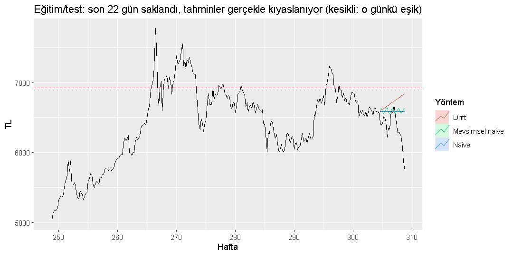

### 6.3 Zaman serisi çapraz doğrulama (tsCV, h = 22)

`tsCV(y, rwf, drift = TRUE, h = 22, lambda = 0)` biçiminde her başlangıç günü için 1–22 gün ileri tahmin yapıldı.

**Son 250 gün drift'in sınanması (23 Kasım, proje sahibinin isteği):** `tsCV(y, rwf, drift = TRUE, h = 22, lambda = 0, window = 250)` ile sınandı. `window = 250`, her başlangıç gününde sadece o güne kadarki son 250 günü kullanır. Bu argüman derste görülmedi, ama bu yöntemi sınamanın tek yolu bu. Yani "geçmişte her gün son 1 yılın eğilimiyle tahmin yapsaydık ne kadar yanılırdık?" sorusu cevaplanıyor.

Bütün yöntemler aynı **1.015 başlangıç günüyle** (500. gün = 1 Aralık 2022'den 21 Ekim 2026'ya) kıyaslandı. İlk yaklaşık 2 yıl dışarıda bırakıldı, çünkü o başlangıçlarda drift eğimi çok az veriyle (ve 2021 şokuyla) hesaplanıyor.

**Tüm ortak başlangıçlar (1.015 gün):**

| Yöntem | RMSE (22. gün) | MAE | MAPE (%) |
|---|---|---|---|
| Ortalama | 3.023,19 | 2.523,47 | 62,80 |
| Naive | 296,75 | 205,11 | 5,34 |
| Mevsimsel naive | 318,71 | 226,09 | 5,88 |
| **Drift (tüm geçmiş)** | **294,71** | 188,02 | **4,56** |
| Drift (son 250 gün) | 296,09 | **187,42** | 4,64 |

**Sadece 2026 başlangıçları (210 gün, 2 Ocak – 21 Ekim 2026):**

| Yöntem | RMSE (22. gün) | MAE | MAPE (%) |
|---|---|---|---|
| **Naive** | **448,75** | **364,69** | **5,49** |
| Mevsimsel naive | 481,72 | 402,86 | 6,05 |
| Drift (tüm geçmiş) | 556,15 | 476,18 | 7,28 |
| Drift (son 250 gün) | 561,13 | 463,66 | 7,06 |

**Başlangıç yılına göre 22. gün RMSE (TL):**

| Yıl | Naive | Mevs. naive | Drift (tümü) | Drift (son 250) |
|---|---|---|---|---|
| 2022 (Ara) | 71,0 | 76,0 | **33,4** | 40,5 |
| 2023 | 110,3 | 121,0 | **89,3** | 95,0 |
| 2024 | 133,6 | 145,1 | **101,5** | 105,9 |
| 2025 | 387,3 | 414,9 | 265,6 | **259,2** |
| 2026 | **448,8** | 481,7 | 556,2 | 561,1 |

**Ufka göre RMSE (TL):**

| h | Naive | Mevs. naive | Drift (tümü) | Drift (son 250) |
|---|---|---|---|---|
| 1 | 68,5 | 143,6 | 68,5 | 68,6 |
| 5 | 144,0 | 144,0 | 143,5 | 143,9 |
| 10 | 195,2 | 195,2 | 194,0 | 194,3 |
| 20 | 283,1 | 283,1 | 280,5 | 282,2 |
| 22 | 296,8 | 318,7 | 294,7 | 296,1 |

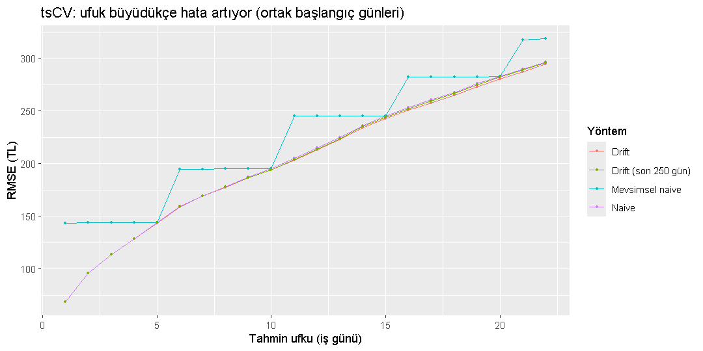

### 6.4 Yorum

- **Kitabın kuralına göre** ("tsCV ile en küçük RMSE'yi veren yöntemi seç") kazanan yine **tüm geçmişle drift** (294,7). Ama fark çok küçük: son 250 gün drift 296,1, naive 296,8 (fark %1'in altında). MAE'de son 250 gün drift çok az önde (187,4 / 188,0), MAPE'de tüm geçmiş drift önde. Önceki sürümde (h = 43) drift naive'den %7 daha iyiydi; ufuk kısalınca yöntemler birbirine yaklaştı, çünkü kısa ufukta eğimin katkısı küçük.
- Mevsimsel naive hiçbir ufukta naive'den iyi değil; haftalık mevsimsellik olmadığı doğrulandı.
- **Rejim değişimi:** 2022–2025 başlangıçlarında drift yöntemleri her yıl en küçük hatayı veriyor. 2026'da tablo tersine dönüyor: naive'in hatası (448,8) drift'inkinin (556,2) çok altında. Yükseliş yıllarında "artış sürer" diyen drift, yatay ve düşen 2026'da "fiyat aynı kalır" diyen naive kazanıyor.
- **Son 250 gün drift:** Tüm dönemde ikinci (296,1), 2025'te en iyisi, 2026'da en kötüsü (561,1). 2026 başında son 250 gün 2025'in güçlü yükselişini içerdiği için yöntem o hızı geleceğe taşıdı. Bugünkü (20 Kasım) başlangıçta pencere 8 Aralık 2025'ten başlıyor ve neredeyse yatay; eğimi ≈ 0, yani bugün naive'e çok yakın tahmin veriyor.
- **Dikkat:** 2026'daki 210 başlangıç günü bağımsız değil. Ardışık başlangıçların 22 günlük dönemleri büyük ölçüde örtüşüyor; bu aslında yaklaşık 10 bağımsız 22 günlük dönem demek.
- **Sonuç:** Uzun dönem kanıtı drift'i, son dönem kanıtı naive'i destekliyor; ama ikisi de bu kez B tarafında (Adım 5). Eşiğin altında kalma **olasılığı** Adım 7'de hesaplandı; yöntem seçimi Adım 8'de.

## 7. Tahmin aralıkları ve karar olasılığı

Kod: `04_tahmin.R` (Adım 7 bölümü). Bütün hesaplar log ölçekte (λ = 0). Sınırlar TL'ye geri dönüştürüldü (Bölüm 3.5 "Dönüşümlü tahmin aralıkları").

> **Ders notu.** Tahmin aralıkları Bölüm 3.5'te anlatılıyor; derste henüz işlenmedi, ama notlarda var. Ders kodlarında karşılığı da var: grafiklerdeki `PI = FALSE` (PI = prediction interval, aralığı çizme demek) ve 27 Ekim'deki yumurta örneğindeki `level = 80`. Derste işlenen kısımla belirsizliği anlatmanın yolu (RMSE ile) 8.4'te ayrıca verildi.

**Tahmin aralığı nedir?** Nokta tahmini tek bir sayı verir ("fiyat 5.961 TL olur"). %80 tahmin aralığı ise "fiyat %80 ihtimalle şu iki değer arasında olur" der. Tahminin ne kadar güvenilir olduğunu gösterir.

### 7.1 22. günün standart sapması (Bölüm 3.5 formülleri)

Artık sd: σ̂ = 0,01470 (günlük log değişim).

| Yöntem | Formül | σ̂₂₂ |
|---|---|---|
| Naive | σ̂·√h | 0,06897 |
| Drift | σ̂·√(h(1 + h/T)) | 0,06946 |
| Kontrol: gerçekleşen 22 günlük log değişimlerin sd'si | — | 0,06718 |

Formül, gerçekleşen 22 günlük değişimlerle uyumlu. Ama oynaklık yıldan yıla çok değişiyor (Adım 4'teki değişen varyans):

| Yıl | Günlük sd | 22 güne çevrilmiş |
|---|---|---|
| 2021 | 0,0217 | 0,102 |
| 2022 | 0,0107 | 0,050 |
| 2023 | 0,0107 | 0,050 |
| 2024 | 0,0098 | 0,046 |
| 2025 | 0,0124 | 0,058 |
| **2026** | **0,0191** | **0,090** |

### 7.2 Tahmin aralıkları, 22 Aralık (TL)

| Yöntem | Nokta (medyan) | %80 normal | %95 normal | %80 bootstrap | %95 bootstrap |
|---|---|---|---|---|---|
| Naive | 5.747,72 | [5.258,72 – 6.282,20] | [5.016,93 – 6.584,97] | [5.290,15 – 6.243,41] | [4.984,41 – 6.545,31] |
| Drift | 5.960,67 | [5.452,99 – 6.515,61] | [5.201,98 – 6.830,00] | [5.486,56 – 6.491,45] | [5.174,75 – 6.847,51] |

- **Elle kontrol:** naive %95 = exp(log 5.747,72 ± 1,96 × 0,06897) = [5.020,97 – 6.579,66]. R'ın değerleriyle neredeyse aynı. Küçük farkın sebebi şu: R naive için σ̂'yı artıkların **sıfır etrafındaki** karesel ortalamasıyla hesaplıyor, √(0,01470² + 0,00165²) = 0,01479. Naive'in artık ortalaması sıfır olmadığı için (yanlılık) bu değer biraz daha büyük çıkıyor.
- **Eşik (6.048,71) iki yöntemin %80 aralığının da içinde.** Yani hiçbir yöntem 22 Aralık'ın eşiğin hangi tarafında kalacağını güvenle söyleyemiyor.
- Geri dönüşümden sonra aralıklar asimetrik: üst taraf daha geniş (log ölçek).
- Bootstrap aralıkları normal aralıklara çok yakın. Kitabın dediği gibi "benzer ama aynı değil". Uzun kuyruklar 22 günlük toplamda büyük ölçüde ortalanıyor.

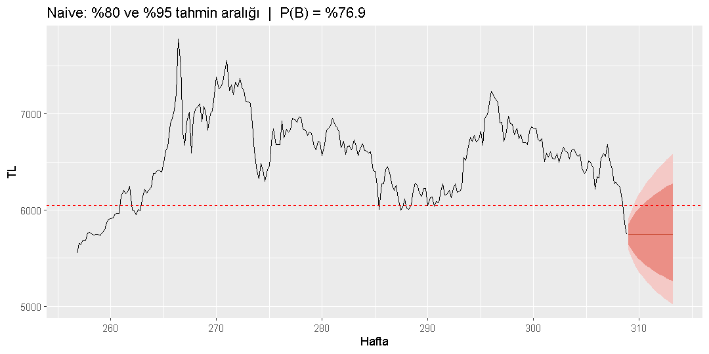
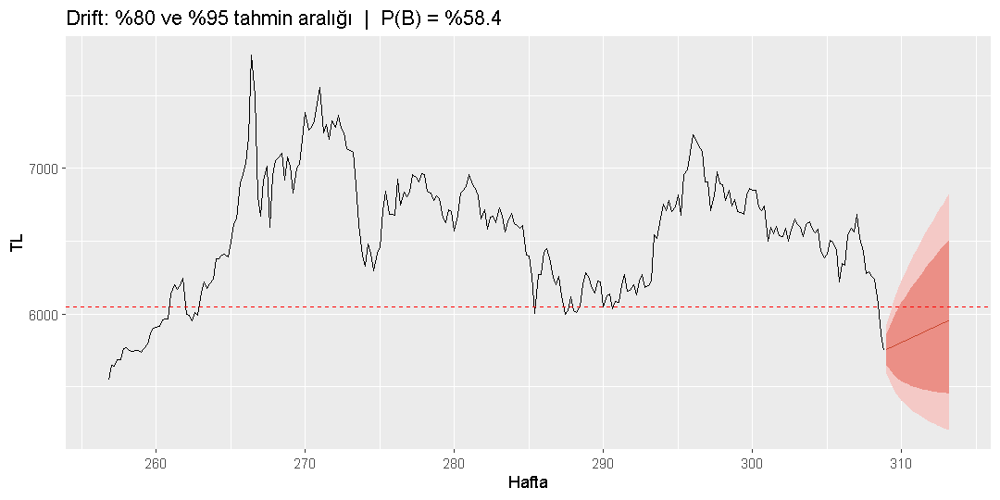

### 7.3 Karar olasılığı: P(B) = P(22 Aralık fiyatı < eşik)

Olasılık, sadece `level` argümanı kullanılarak bulundu. Tahmin aralığı, sınırı tam eşiğe değene kadar daraltılıp genişletildi. Ana yöntemde (drift, tüm geçmiş) nokta tahmini eşiğin altında; %16,7'lik aralığın **üst** sınırı tam eşik çıkıyor:

```
rwf(y, h = 22, lambda = 0, drift = TRUE, level = 16.7)  ->  %16,7 aralığı: 5.874,0 – 6.048,6

         %41,65                   %16,7               %41,65
 ◄──────────────────────[5.874 ─────── 6.049]──────────────────────►
     eşiğin altı                       ↑ eşik          eşiğin üstü
```

- Fiyat %16,7 ihtimalle bu aralığın içinde kalır. Geri kalan %83,3 iki yana eşit bölünür: %41,65 altta, %41,65 üstte.
- **Eşiğin altı = alt kısım + aralığın içi = %41,65 + %16,7 = %58,35 ≈ %58 = P(B).** Eşiğin üstü = %42 = P(A).
- Genel kural: nokta tahmini eşiğin altındaysa ve eşik %L'lik aralığın üst sınırındaysa, P(B) = %L + (100 − L)/2. Nokta eşiğin üstündeyse eşik alt sınırdadır ve P(B) = (100 − L)/2.

| Yöntem | Nokta (TL) | Eşiğin sınırda olduğu aralık | Kontrol: o aralığın sınırları | **P(B)** | P(A) |
|---|---|---|---|---|---|
| Naive | 5.747,72 | %53,8 (üst sınır) | 5.461,8 – **6.048,7** | **%76,9** | %23,1 |
| Drift (tüm geçmiş) | 5.960,67 | %16,7 (üst sınır) | 5.874,0 – **6.048,6** | **%58,4** | %41,6 |
| Drift (son 250 gün) | 5.748,62 | %42,0 (üst sınır) | 5.463,5 – **6.048,7** | **%71,0** | %29,0 |

Bu sonuçlar, Bölüm 3.5'teki "tahmin hataları normal dağılır" varsayımına dayanıyor (R'ın aralıkları da bu varsayımla hesaplanıyor). Son 250 gün drift'in aralığı naive'inkinden geniş, çünkü son 1 yılın oynaklığı (2026) tüm dönemden yüksek.

### 7.4 Duyarlılık kontrolleri

| Kontrol | Naive P(B) | Drift (tüm geçmiş) P(B) | Drift (son 250 gün) P(B) |
|---|---|---|---|
| Ana sonuç (λ = 0) | %76,9 | %58,4 | %71,0 |
| λ = 0,084 (BoxCox.lambda önerisi) | %78,9 | %61,3 | %70,8 |

- **Yanlılık düzeltmesi (biasadj, Bölüm 3.2):** ortalama tahmin medyanın yaklaşık 14 TL üstünde (naive 5.761,56; drift 5.975,05). Karar "eşiğin altında mı" sorusu olduğu için medyan ve olasılık daha uygun; ortalama sonucu değiştirmiyor.
- λ = 0,084 ile sonuçlar neredeyse aynı; yön hiçbir yöntemde değişmiyor.

### 7.5 Yorum

- **Bütün yöntemler B tarafında.** "Fiyat bugünkü gibi kalır" (naive) ile B'nin olasılığı yaklaşık **%77**, "son 1 yılın eğilimi" ile **%71**, "2021'den beri süren artış sürer" (tüm geçmiş drift) ile **%58**.
- **Hiçbir senaryoda olasılık %80'e ulaşmıyor.** Eşik bütün %80 aralıklarının içinde kalıyor; karar her durumda belirsizlik altında verilecek.
- Bu olasılıklar artıkların ilişkisiz olduğunu varsayıyor. Adım 4'te küçük ama anlamlı otokorelasyon ve değişen varyans bulunmuştu; aralıklar yaklaşık doğru kabul edilmeli.

## 8. Sonuç ve karar

Kod: `04_tahmin.R` (Adım 8 bölümü). Yeni model kurulmadı; Adım 5–7'nin özeti.

Bölüm 1.2'ye göre tahmin, hedef ve planlama ayrı şeyler. Biz **tahmin** (olasılık dağılımı) üretiyoruz; A/B **kararı** bu dağılıma bakılarak veriliyor. Bu bir ders projesidir, yatırım tavsiyesi değildir.

### 8.1 Sonuç tablosu (karar günü 22 Aralık, h = 22, eşik 6.048,71 TL)

| Yöntem | Nokta (medyan, TL) | %80 aralık | %95 aralık | P(B) | tsCV RMSE (tüm) | tsCV RMSE (2026) | Beklenen fark, 5 gram (TL) |
|---|---|---|---|---|---|---|---|
| Naive | 5.747,72 | 5.259 – 6.282 | 5.017 – 6.585 | %76,9 | 296,8 | **448,8** | −1.436 (B lehine) |
| **Drift (tüm geçmiş)** | **5.960,67** | 5.453 – 6.516 | 5.202 – 6.830 | **%58,4** | **294,7** | 556,2 | **−368 (B lehine)** |
| Drift (son 250 gün) | 5.748,62 | 5.110 – 6.467 | 4.801 – 6.884 | %71,0 | 296,1 | 561,1 | −1.379 (B lehine) |

- Beklenen fark = 5 × (beklenen fiyat − eşik). A'nın B'ye göre ortalama TL farkıdır. Beklenen fiyat, R'ın `biasadj = TRUE` ile verdiği yanlılık düzeltmeli ortalamadır (Bölüm 3.2): naive 5.761,56, drift 5.975,05, son 250 gün drift 5.772,92 TL. Pozitifse A, negatifse B lehine. Ortalamada kaç TL fark edeceği sorusunu cevaplar; zaman serisi dersinin dışında basit bir beklenen değer hesabıdır.
- Ortalama ve mevsimsel naive tabloya alınmadı: ortalama trendli seride anlamsız, mevsimsel naive hiçbir ufukta naive'den iyi değil (Adım 6).

### 8.2 Kanıtların özeti

| Kanıt | Hangi yöntemi destekliyor | Güç |
|---|---|---|
| tsCV RMSE, 1.015 başlangıç (Ara 2022 – Eki 2026) — kitabın seçim kuralı | Drift (tüm geçmiş) | Zayıf: fark %1'in altında; başlangıçlar örtüşüyor ve dönem ağırlıkla yükseliş yılları |
| Artık ortalaması sıfır mı? (Bölüm 3.3) | Drift | Naive'in artık ortalaması 0,00165 > 0 (yanlı) |
| tsCV, sadece 2026 başlangıçları (210 gün) | Naive | Orta: yaklaşık 10 bağımsız 22 günlük dönem |
| Eğitim/test, son 22 gün | Naive | Zayıf: tek dönem |
| 2026 artık ortalaması (Adım 4) | Naive (22 günde ~−%0,3) | Zayıf–orta |

Yöntem seçimi hangi tarafa giderse gitsin, nokta tahminleri (mevsimsel naive dışında) ve olasılıkların hepsi **B** tarafında.

### 8.3 Seçilen yöntem: Drift (tüm geçmiş)

**Gerekçe** (23 Kasım, proje sahibinin kararı):
- **Kitabın seçim kuralı (Bölüm 3.4):** "En iyi tahmin modelini seçmenin iyi bir yolu, zaman serisi çapraz doğrulamasıyla hesaplanan en küçük RMSE'ye sahip modeli bulmaktır." 1.015 başlangıç gününde 22 gün sonraki en küçük hata drift'te: RMSE 294,7 (son 250 gün drift 296,1, naive 296,8). Bütün ufuklarda (1–22 gün) en küçük ya da eşit en küçük hata onda.
- **Artık kontrolü (Bölüm 3.3):** Artık ortalaması sıfır olan tek yöntem drift. Naive'in artık ortalaması 0,00165 > 0, yani naive yanlı.

**Seçim süreci:**
1. 12 Kasım'da proje sahibi yapısal değişim yargısıyla (Bölüm 1.4) **son 250 günlük drift'i** seçti.
2. 23 Kasım'da proje sahibinin "sınamadan karar vermeyelim" isteğiyle bu yöntem `tsCV(window = 250)` ile sınandı. Tüm dönemde ikinci, 2026 başlangıçlarında son çıktı.
3. Sınama yargısal seçimi desteklemediği için proje sahibi, kitabın kuralına göre **en küçük RMSE'yi veren tüm geçmişle drift'e** geçti.
4. 22 Kasım güncellemesinde (yeni veri, h = 22) sınama tekrarlandı; sıralama değişmedi (294,7 / 296,1 / 296,8), ama yöntemler arasındaki fark çok küçüldü.

**Zayıf yönü:** 2026 başlangıçlarında drift'in hatası (556) naive'inkinden (449) büyük. Bu yıl fiyat yatay gidip düştüğü için "2021'den beri süren artış sürer" varsayımı yanıldı. Ana yöntem B'yi en zayıf gösteren yöntem; diğer iki senaryo B'yi daha güçlü gösteriyor.

### 8.4 Sonuç

> **Ana yönteme (drift, tüm geçmiş) göre 22 Aralık kapanışının eşiğin altında kalma olasılığı %58, üstüne çıkma olasılığı %42. Yani B daha olası, ama karar belirsiz.** Nokta tahmini 5.960,67 TL, eşiğin 88 TL altında; %80 aralığı 5.453 – 6.516 TL ve eşik bu aralığın içinde. 5 gram için beklenen fark −368 TL, B lehine.
>
> **Karar ne kadar sağlam?** Yön açısından orta: bütün senaryolar B'yi gösteriyor. Fiyat yatay kalırsa (naive) P(B) %77, son 1 yılın eğilimiyle %71, uzun dönem artış sürerse (ana yöntem) %58. λ = 0,084 ile ana yöntemin P(B)'si %61. Ama ana yöntemde olasılık %50'ye yakın; 22 günde %5,24'lik bir artış (son 6 yılın ortalama hızının yaklaşık 1,4 katı) olursa sonuç A'ya döner.

| Senaryo | P(B) | Yön |
|---|---|---|
| **Drift (tüm geçmiş) — ana yöntem, "uzun dönem artış sürer"** | **%58,4** | **B (hafif)** |
| Drift (son 250 gün) — "son 1 yılın eğilimi" | %71,0 | B |
| Naive — "fiyat yatay kalır" | %76,9 | B |

**Önceki sürümle (22 Ekim) karşılaştırma:** O sürümde ana yöntem A'yı gösteriyordu (P(B) %38). Değişimin üç sebebi var:
1. **Fiyat düştü:** 6.433,97 → 5.747,72 (−%10,7).
2. **Eşik oranı büyüdü:** Gram başına yaklaşık 300 TL'lik fark daha düşük bir fiyata oranla daha büyük: %4,66 → %5,24. (22 Ekim sürümünde BES kazancı yuvarlak 1.500 TL alınmıştı; 23 Kasım'da senaryodaki hesapla 1.504,94 TL oldu. Bu fark eşiği sadece 0,99 TL değiştiriyor.)
3. **Ufuk kısaldı:** 43 → 22 iş günü. Drift'in birikmiş beklenen artışı 0,0753'ten 0,0364'e düştü; artık eşiğin (0,0510) altında.

**Aynı sonuç, sadece derste işlenen kısımla (nokta tahmini + RMSE):**

Tahmin aralıkları kullanılmasa da belirsizlik Adım 6'nın hata ölçüleriyle görülebiliyor:

| | TL |
|---|---|
| Ana yöntemin nokta tahmini ile eşik arasındaki fark | **88** |
| Drift'in tsCV'de 22 gün sonraki tipik hatası (RMSE), tüm dönem | 295 |
| Drift'in tsCV'de 22 gün sonraki tipik hatası (RMSE), 2026 başlangıçları | 556 |

Drift'in 22 gün sonraki olağan hatası, tahmin ile eşik arasındaki farkın **3 ila 6 katı**. Yani nokta tahmini eşiğin altında olsa da (B), 22 Aralık fiyatının tipik bir hatayla eşiğin üstüne çıkması kolay. Bu yoldan varılan sonuç da aynı: **tahmin B diyor, ama karar belirsiz.** Tahmin aralıkları bu belirsizliği "%58'e %42" diye sayıya döküyor.

## 9. Gerçek değerlendirme (karar günü)

*⏳ Henüz yapılmadı.* 22 Aralık 2026 kapanışı gelince: gerçekleşen fiyat eşiğin hangi tarafında, aralıkların içinde mi, tahmin ne kadar yanıldı? Tek gözlemle yöntem seçilemeyeceği not edilecek; yöntem karşılaştırmasının asıl dayanağı 6.3.

## Sınırlılıklar

- Analiz 20 Kasım 2026 kapanışına göre (22 Kasım güncellemesi).
- Sadece Bölüm 1–3'ün dört kıyaslama yöntemi kullanıldı (ortalama, naive, mevsimsel naive, drift). Bunlar giriş düzeyinde yöntemler; trendin değişmesini ya da oynaklığı modelleyemiyorlar.
- Ana yöntem (drift, tüm geçmiş) çapraz doğrulamada en iyi, ama farkı çok küçük ve 2026 başlangıçlarında naive'den kötü (8.3).
- Mevsimsellik değerlendirmesi yalnızca 5–6 yıllık aylık gözleme dayanıyor.
- Günlük değişimlerde küçük ama tüm dönemde anlamlı otokorelasyon var (Ljung-Box p = 0,0005; 2022 sonrası p = 0,06). İlk üç bölümün yöntemleri bu yapıyı modelleyemiyor.
- Günlük değişimlerin varyansı zamanla değişiyor ve dağılım normalden uzun kuyruklu. Tahmin aralıkları ve P(B) normal dağılım varsayımına dayandığı için yaklaşık değerler olarak okunmalı.
- 2026'daki "yatay / düşen piyasa" kanıtı kısa bir döneme (yaklaşık 10 bağımsız 22 günlük dönem) dayanıyor.
